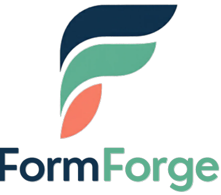
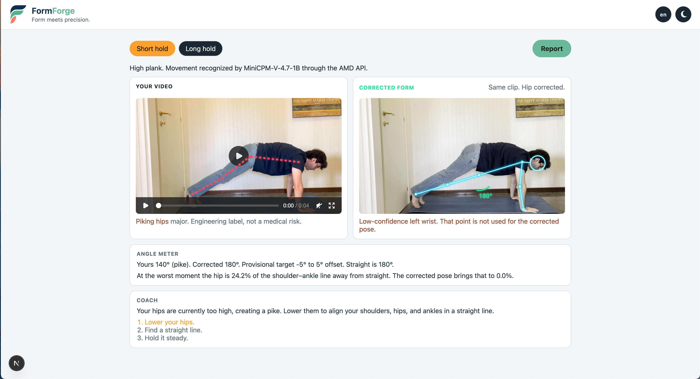
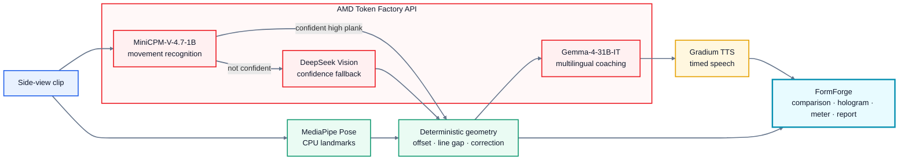

<p align="center">
  
</p>

<p align="center">
  <strong>Form meets precision.</strong><br>
  Your own clip, beside the same rep with the form corrected.
</p>

<p align="center">
  <strong>AMD Token Factory · MiniCPM-V / DeepSeek Vision · MediaPipe Pose · Gemma 4 · Gradium TTS</sub>
</p>

<p align="center">
  
</p>

Most form analysis stops at a skeleton, a score, or a warning. **FormForge shows the corrected form on the movement you actually recorded**: same person, same timing, same camera view.

This hackathon POC focuses on one thing and makes it unmistakable: a side-view high plank with piking. The original clip shows the measured shoulder–hip–ankle path. Beside it, deterministic geometry places the hip on the straight line and draws a cyan hologram over the same video. Straight reads as **180°**. A live meter explains the difference, and a short spoken cue arrives on the matching frames.

## Why it is different

FormForge does not replace your rep with a trainer, a stock example, or a generic “perfect pose.” It keeps the original clip visible and computes the corrected form for that frame.

- **Your video** shows the measured shoulder–hip–ankle path. The dotted line moves from red toward green as the hips approach the configured band.
- **Corrected form** plays the same clip beside it. Hands and feet remain where they were measured while the hip is placed on the shoulder–ankle line and the knee follows.
- **Live angle meter** shows the user value, corrected value, and provisional target for the frame being played.
- **Line gap** makes the correction tangible: hip distance from the shoulder–ankle line, divided by that line’s length. The saved demo’s worst frame is `24.2%`; its corrected form is `0.0%`.
- **Multilingual coach** shows two or three timed lines written by Gemma and spoken by Gradium.
- **One-page report** captures the hold length, peak deviation, time outside the band, line gap, worst frame, and coaching lines.

The interface supports English, French, Spanish, German, and Portuguese. Short hold and Long hold are saved analyses of the same plank, so the visual comparison can be demonstrated instantly.

## How it works

**Geometry owns the correction. AI explains it.**

MediaPipe extracts pose landmarks on CPU. Deterministic Python chooses the visible side, measures the hip offset and line gap, detects `hip_misalignment`, and produces corrected keypoints. The language models never invent the angle or move a joint.




- **Movement recognition:** `MiniCPM-V-4.7-1B` sees sampled frames first. `DeepSeek-V4-Flash-Vision-Exp` is consulted only when MiniCPM is not confident. Both run through AMD Token Factory.
- **Pose:** MediaPipe Pose Landmarker runs locally on CPU and exposes the documented COCO-17 subset.
- **Correction:** Deterministic Python measures the configured plank geometry and produces corrected keypoints.
- **Coaching:** `Gemma-4-31B-IT` receives only the validated finding and frame spans, then writes a summary and two or three short cues in the selected language.
- **Speech:** Gradium speaks each finished cue without rewriting it.

## The measurement

The visible side is the shoulder, hip, and ankle the pose model sees more clearly. The published measurement uses those three observed joints directly.

**Hip offset** is the signed angle, in degrees, of the hip relative to the shoulder–ankle segment.

- `0` is a straight line. The meter shows that as `180°`.
- A positive offset is a sag: the hip is on the ground side of the line.
- A negative offset is a pike.

The provisional target band is `-5°` to `5°` of offset, in `backend/app/config/exercises/high_plank.json`. It is the demo rule for this check, not a clinical standard. Severity (`minor`, `moderate`, `major`) is an engineering label, not a medical risk score. 

## Multilingual coaching

Gemma writes the coach in the selected language. Gradium uses one heard library voice per language:

`GRADIUM_VOICE_ID_EN`, `GRADIUM_VOICE_ID_FR`, `GRADIUM_VOICE_ID_ES`, `GRADIUM_VOICE_ID_DE`, `GRADIUM_VOICE_ID_PT`.

English on the demo plays the coach saved with the clip. Another language asks Gemma once, saves the text, speaks it, and reuses that result. A language with no configured voice still shows the text.

## Roadmap

**The next attempt.** After this plank demo is accepted, the same person records the same hold again. The two clips are compared on hip offset and line gap, so the measured change is visible.

**Practice for a repeated pattern.** When that same measured error shows up again, FormForge can offer a few related movements that practice the pattern. A plank whose hip keeps leaving the line through the legs can lead to movements that train the same hip and leg line. Each suggestion is its own checked movement, with the same kind of correction, meter, and cue.

**An every-movement platform.** The long-term aim is to support every movement that can be expressed as a validated visual check: strength training, calisthenics, mobility, yoga, meditation postures, and physiotherapy movements. Each movement receives its own joints, geometry, target, correction rule, and evidence. Fitness checks can be coach-reviewed; physiotherapy checks can be clinician-designed and validated. The same pose platform and playback experience serve the full library.

**AMD GPU across the media pipeline.** Today the language and vision models are reached through AMD Token Factory while pose and geometry run locally on CPU. The GPU roadmap moves the compute-heavy video path—decode and frame preparation, scalable pose inference, smoothing, batch analysis, and concurrent-session processing—to AMD GPU infrastructure. That turns the single-clip POC into a high-throughput movement-analysis service while preserving deterministic correction and reporting the device that actually ran each stage.

**Live FormForge.** Add a real-time camera mode with continuous pose tracking, the red-to-green alignment path, corrected hologram, live angle meter, confidence checks, and frame-triggered voice guidance while the person is moving or holding a pose.

**Movement knowledge for robotics.** Turn the validated movement library into machine-readable representations of human motion: observed joints, temporal phases, geometric constraints, confidence, and deterministic correction rules. Future robotics research could use that knowledge to help robots interpret, reproduce, and teach human movement while preserving traceable rules instead of relying on generated motion alone.

**Validated movement intelligence.** Build consented datasets with expert labels, reproducible geometry benchmarks, coach review for sport checks, and clinician-led studies for physiotherapy use cases.

## Quick start

Requirements: Python 3.12, Node.js 22, ffmpeg, and ffprobe.

```bash
python3.12 -m venv backend/.venv
backend/.venv/bin/pip install -r backend/requirements.txt
mkdir -p backend/models
curl -L -o backend/models/pose_landmarker_full.task \
  https://storage.googleapis.com/mediapipe-models/pose_landmarker/pose_landmarker_full/float16/latest/pose_landmarker_full.task

cp .env.example .env
cd frontend && npm install && npm run dev
```

Open [http://localhost:3000](http://localhost:3000).

Fill `.env` from the Token Factory console at [notebooks.amd.com/tokenfactory](https://notebooks.amd.com/tokenfactory) and from Gradium. The key names are `TOKEN_FACTORY_API_KEY` and `GRADIUM_API_KEY`. Leave a voice id empty until that voice has been heard in its language. Do not commit `.env`.

Short hold and Long hold play the prepared analyses immediately when the local demo media is present. Provider keys are used when another language needs a coach or when a new clip is analyzed.

## Analyze a clip

From the repository root, put the video inside its job folder and analyze it. The script transcodes the video, extracts frames, runs pose, the plank check, the vision label, Gemma, and Gradium, then writes `result.json` in that folder.

```bash
JOB=data/jobs/$(uuidgen | tr '[:upper:]' '[:lower:]')
mkdir -p "$JOB"
cp /path/to/side-view-plank.mov "$JOB/source.mov"
MPLCONFIGDIR=/tmp/mpl backend/.venv/bin/python backend/scripts/analyze_video.py \
  --video "$JOB/source.mov" \
  --job-dir "$JOB" \
  --lang en
```

`--lang` accepts `en`, `fr`, `es`, `de`, or `pt`.

The Next.js app exposes the same local workflow through `POST /api/analyze`; the client polls `GET /api/jobs/{job_id}`. That route depends on the Python environment and local writable job storage, so the static saved demo and the full upload pipeline are separate deployment concerns.

`backend/scripts/run_clip.py` rebuilds the demo result from frames already extracted at 30 fps.

```bash
MPLCONFIGDIR=/tmp/mpl backend/.venv/bin/python backend/scripts/run_clip.py \
  --frames /tmp/formforge-frames \
  --result frontend/src/data/result.json \
  --audio-dir frontend/public/coach \
  --audio-prefix /coach \
  --lang en
```

## Tests

Geometry tests check the angle sign, aspect-ratio handling, visible-side selection, line gap, confidence policy, correction constraints, and language voice lookup. Real-world pose accuracy is **not measured yet**; a documented evaluation set is part of the roadmap.

```bash
cd backend && MPLCONFIGDIR=/tmp/mpl .venv/bin/python -m unittest discover -s tests
cd frontend && node --experimental-strip-types --test src/lib/playback.test.ts src/lib/i18n.test.ts
```

## Responsible design

FormForge visualizes measured movement geometry and its configured target. Medical diagnosis, treatment, and clinical safety decisions remain with appropriately qualified professionals. A reported-pain path gives a neutral professional handover.

## License

FormForge’s project-authored source code is licensed under the **MIT License**. Third-party models, libraries, services, and brand marks remain subject to their owners’ licenses and terms; their attributions are recorded in `docs/LICENSES.md`.
